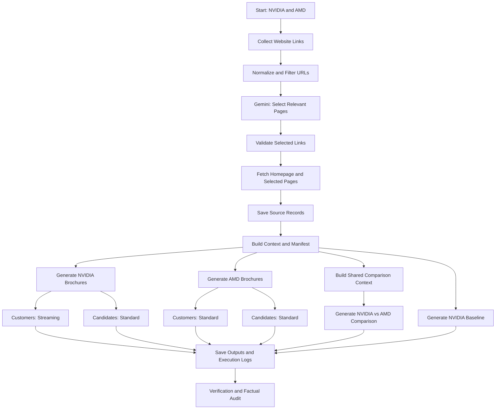

# Advanced Company Brochure Generator
## NVIDIA vs AMD — AI-Powered Company Research and Comparison

## 1. Project Overview

This project implements an AI-powered company research and brochure generation system using Python and Google's Gemini API.

The system collects information from company websites, selects relevant pages, extracts website content, and uses an LLM to generate audience-specific brochures and a comparison between two companies.

The project focuses on two companies:
- NVIDIA
- AMD

The generated deliverables include:
- NVIDIA brochure for potential customers.
- NVIDIA brochure for potential job candidates.
- AMD brochure for potential customers.
- AMD brochure for potential job candidates.
- NVIDIA vs AMD company comparison.
- NVIDIA baseline brochure for comparison with the improved generation process.

One of the four brochures is generated using streaming, allowing the generated text to be displayed progressively.

The system also includes execution logging, context management, source validation, and output verification.

---

## 2. System Architecture

The solution follows a predefined workflow in which Python controls the execution sequence and Gemini performs specific language-model tasks.

### Architecture Diagram



### Workflow Description

1. **Website Link Collection:** Python collects links from the NVIDIA and AMD websites.
2. **Link Normalization:** URLs are normalized, duplicates are removed, and external links are filtered.
3. **Link Selection:** Gemini selects up to three additional relevant pages for each company.
4. **Link Validation:** Python validates the model response and rejects invalid selections.
5. **Source Collection:** The homepage and selected pages are fetched and their contents are extracted.
6. **Context Construction:** Relevant source information is organized into contexts with a defined character budget.
7. **Content Generation:** Gemini generates four brochures, one comparison, and one baseline brochure.
8. **Saving and Logging:** Prompts, outputs, metadata, and execution information are saved.
9. **Verification:** The generated deliverables are checked for completeness, word count, source references, and other requirements.

---

## 3. Division of Responsibilities: Python and Gemini

The system separates deterministic application logic from language-model tasks.

| Python Responsibilities | Gemini Responsibilities |
|---|---|
| Website scraping | Selecting relevant website pages |
| URL normalization | Understanding page relevance |
| Filtering external URLs | Generating brochure content |
| Validating JSON responses | Adapting content to target audiences |
| Managing source records | Comparing NVIDIA and AMD |
| Managing context budgets | Generating natural-language analysis |
| Saving prompts and outputs | Producing Hebrew content |
| Execution logging | Following generation instructions |
| Output verification | |

Python controls which information reaches the model and validates the model's responses before they are used.

Gemini is responsible for language understanding, content selection, and generation.

The model does not independently control the entire application workflow.

---

## 4. Project Structure

```text
assignment1-brochures/
│
├── data/
│   ├── prompts/
│   ├── responses/
│   ├── sources/
│   └── contexts/
│
├── logs/
│   ├── run_log.jsonl
│   └── link_rejections/
│
├── notebooks/
│   └── assignment1.ipynb
│
├── outputs/
│   ├── brochures/
│   ├── streaming/
│   ├── comparisons/
│   ├── baseline/
│   └── reports/
│
├── src/
│   └── assignment1_brochures/
│       ├── __init__.py
│       ├── config.py
│       ├── context.py
│       ├── generation.py
│       ├── link_selection.py
│       ├── logging_utils.py
│       ├── prompts.py
│       ├── scraping.py
│       ├── sources.py
│       └── streaming.py
│
├── tests/
│
├── .env.example
├── .gitignore
├── .python-version
├── main.py
├── pyproject.toml
├── scraper.py
├── README.md
└── uv.lock
```

### Main Modules

| Module | Responsibility |
|---|---|
| `config.py` | Loads environment variables, model configuration, and Gemini client |
| `prompts.py` | Stores system prompts and prompt-building functions |
| `scraping.py` | Provides website scraping functions |
| `link_selection.py` | Normalizes, selects, and validates website links |
| `sources.py` | Fetches company website content and saves source records |
| `context.py` | Builds context files and manifests within the character budget |
| `generation.py` | Generates standard brochures, comparisons, and baseline outputs |
| `streaming.py` | Handles streaming generation and interrupted responses |
| `logging_utils.py` | Records execution information in the JSONL log |
| `main.py` | Provides the main application entry point and execution modes |
| `scraper.py` | Contains the original website scraping implementation |

The notebook is retained as a development and learning environment. The main implementation is organized into reusable Python modules.

---

## 5. Source Collection and Context Management

The system collects and stores company information before generating any brochures.

### Source Record Structure

Each collected webpage is stored as a structured source record containing:

| Field | Description |
|---|---|
| `source_id` | Unique source identifier |
| `company_id` | Company identifier |
| `url` | Original webpage URL |
| `title` | Extracted webpage title |
| `retrieved_at` | Collection timestamp |
| `text` | Extracted webpage content |
| `status` | Collection result |

Source identifiers follow a consistent convention:

- NVIDIA: A1–A4.
- AMD: B1–B4.

The homepage receives the first source ID, followed by additional selected pages in their saved selection order.

The source status can be:

- `ok`: Content successfully collected.
- `empty`: Page returned no usable text.
- `failed`: Collection failed.

Empty or failed sources are not used as evidence.

### Context Processing

The `build_context()` function prepares context from collected source records.

1. Only sources with status `ok` and non-empty text are included.
2. Each source receives a metadata section containing its ID, title, URL, and content heading.
3. The context is limited by a configurable character budget of 12,000 characters.
4. Metadata overhead is accounted for before allocating the remaining text budget.
5. The available text budget is divided equally between valid sources.
6. Sources that exceed their allocation are truncated.
7. Sources that are unavailable or empty are recorded as omitted.

The metadata and source identifiers are preserved when content is truncated.

### Context Manifest

For each generated context, a JSON manifest is saved.

The manifest records:
- Output name.
- Configured text budget.
- Actual number of characters used.
- Included source IDs.
- Truncated sources.
- Omitted sources and their reasons.

Separate contexts are maintained for NVIDIA, AMD, and the combined company comparison.

The comparison uses one shared context budget for both companies.

This approach provides controlled input sizes and traceability between generated content and its original sources.

---

## 6. Validation and Quality Control

The system includes validation at several stages to reduce errors and improve reliability.

### Link Validation

Before Gemini is called, Python prepares and normalizes the candidate URL list.

The normalization process:
- Resolves relative URLs.
- Removes URL fragments.
- Removes duplicates.
- Filters empty URLs.
- Rejects external websites.
- Accepts only HTTP and HTTPS.
- Treats www and non-www versions of the same website as equivalent.

Model-generated link selections must:
- Return valid JSON.
- Contain a `links` list.
- Include non-empty `type`, `url`, and `reason` fields.
- Select no more than three additional pages.
- Use only URLs from the candidate list.
- Avoid duplicate URLs.
- Avoid selecting the homepage.
- Avoid privacy and terms-of-service pages.

If any selected link is invalid, the entire selection is rejected.

The rejected response and its rejection reason are saved for review. Invalid selections are not used to fetch additional pages.

### Source Validation

Each collected source receives one of the following statuses:

| Status | Meaning |
|---|---|
| `ok` | Content successfully collected |
| `empty` | Page returned no usable text |
| `failed` | Collection failed |

Only successfully collected sources are included in the context.

### Output Validation

Generated deliverables are checked for:
- Required file existence.
- Word count between 200 and 300 words for brochures.
- Source references in the generated content.
- Presence of a source list.
- Existence of comparison and baseline outputs.

Word counts are calculated using Python's `split()` method, excluding the source list.

A manual factual audit is also performed to assess whether the generated claims are supported by the collected sources.

---

## 7. Testing and Failure Handling

The project includes local tests that simulate potential failures without requiring additional API calls.

### Link Selection Tests

The tests cover:
- Malformed JSON responses.
- URLs that were not included in the candidate list.
- Duplicate URLs.
- Forbidden URLs.
- Invalid items inside otherwise valid selections.

The system rejects the entire response when validation fails, preventing invalid pages from being fetched.

### Source Collection and Context Tests

The tests cover:
- Empty sources.
- Failed sources.
- Sources containing unusually long text.
- Context budget allocation and truncation.
- Preservation of source metadata and identifiers.

### Streaming Tests

The streaming implementation handles:
- Events containing no text.
- `None` events.
- Empty choices.
- Interrupted streams.
- Exact preservation of accumulated text.

Simulated streaming events are used to verify that the system does not crash or append the word `None` to the generated content.

These tests demonstrate that the system handles expected failure scenarios without depending on live service failures.

---

## 8. Prompt Design

The project separates prompt definitions from generation logic.

The `prompts.py` module contains:
- `LINK_SYSTEM_PROMPT`
- `build_link_selection_prompt()`
- `build_brochure_prompt()`
- `build_comparison_prompt()`
- `build_baseline_prompt()`
- `COMPARISON_DIMENSIONS`

This makes prompts easier to maintain and modify without changing the generation functions.

### Comparison Dimensions

The NVIDIA vs AMD comparison uses four dimensions defined before generation:

1. Products and services.
2. Target customers.
3. AI and computing capabilities.
4. Careers and work environment.

The comparison presents information from both companies using the collected sources and includes citations.

Differences are described only when the available sources provide a reasonable basis for comparison. More detailed information on one company's website is not treated as evidence that the company is superior.

### Prompt Changes vs. Source Changes

These two types of changes can affect generated results differently.

**Changing the prompt:**

A prompt change modifies the instructions provided to Gemini.

For example:
- Changing the emphasis of a customer brochure.
- Requesting more technical explanations.
- Modifying the structure of the comparison.

The source information remains unchanged, but the model may produce a different result because it is following different instructions.

**Changing the source material:**

A source change modifies the information available to Gemini.

For example:
- Adding a new product page.
- Updating company information.
- Adding a new careers page.
- Removing an irrelevant source.

The model receives different information, which may change the factual content and conclusions of the generated output.

Therefore, prompt changes affect how the model uses the information, while source changes affect the information itself.

---

## 9. Streaming Generation

One brochure is generated using streaming.

The `generate_brochure_stream()` function requests a streamed response from Gemini and processes the incoming events using `process_stream_events()`.

The system:
- Accumulates generated text.
- Updates the displayed content progressively.
- Detects successful completion.
- Preserves text received before an interruption.
- Saves the generated output.
- Records the execution status and metadata.

Streaming provides progressive output instead of waiting for the entire response to be generated.

---

## 10. Execution Logging and Traceability

Every operation is recorded in:

```text
logs/run_log.jsonl
```

The log uses JSON Lines format, meaning each execution is stored as a separate JSON record.

Each record contains:

| Field | Description |
|---|---|
| `run_id` | Unique execution identifier |
| `timestamp` | Execution timestamp |
| `company` | Company associated with the operation |
| `audience` | Target audience, when relevant |
| `operation` | Operation performed |
| `model` | Model used |
| `duration_seconds` | Execution duration |
| `status` | Success, failure, or partial completion |
| `input_paths` | Paths to input files |
| `output_paths` | Paths to generated files |
| `token_usage` | Token usage when actually reported by the API |
| `api_calls` | Number of attempted model API calls |
| `http_requests` | Number of attempted website HTTP requests |
| `error` | Error information, when applicable |

Token usage is not estimated when the API does not provide it.

API calls and website HTTP requests are counted separately.

The logging system also records failed operations, allowing execution failures to be reviewed rather than silently ignored.

New full runs record the exact prompt, saved context, and context manifest in each brochure's log entry. Paths in a live run's log are relative to its `runs/<run-id>/` directory.

The four historical brochures have run IDs and saved outputs, but their original prompts were not archived. The notebook records the generation and save steps and identifies the context variables used. Its historical context-build output reports 7,801 characters for NVIDIA and 7,882 for AMD, while the current context files differ in length. The saved manifests let verify mode check the recorded source IDs, but the exact historical prompt and context text remain unverified. The historical log retains missing values as recorded.

API keys and other secrets are kept in environment variables and excluded from version control.

---

## 11. Baseline Experiment and Factual Audit

### Baseline Experiment

A baseline brochure is generated for NVIDIA's potential customer audience.

The baseline and improved versions use:
- The same Gemini model.
- The same model configuration.
- The same source context.
- The same target audience.
- The same language and required word count.

Only the prompt instructions and requested structure are changed.

The comparison evaluates four predefined criteria:

1. **Faithfulness:** Whether the content accurately reflects the supplied sources.
2. **Audience Fit:** Whether the brochure addresses the intended audience.
3. **Information Coverage:** Whether the relevant company information is included.
4. **Clarity:** Whether the information is organized and easy to understand.

Concrete examples are used to identify improvements or limitations.

The experiment is not intended to establish a general ranking of language models.

### Manual Factual Audit

A manual audit examines eight factual claims across the four generated brochures.

The sampling rule is two initial factual claims from each brochure.

Each claim is documented with:
- Original claim.
- Brochure name.
- Supporting source ID.
- Source URL.
- Supporting evidence excerpt.
- Audit decision.

Each claim receives one of four classifications:

- Supported.
- Partially supported.
- Unsupported.
- Contradicted by the source.

The original generated outputs are preserved, and any corrections or missing evidence are documented.

---

## 12. Workflow vs. Agent

The implemented solution is a predefined Workflow rather than an autonomous Agent.

### Workflow

A Workflow follows a predetermined sequence of operations.

In this project:
- Python defines the execution order.
- Each function has a specific responsibility.
- Gemini performs selected tasks within the workflow.
- Validation is performed at predefined checkpoints.
- The next operation is determined by the application code.

This makes the solution predictable, reproducible, and easier to debug.

### What Would Be Required to Build an Agent?

To transform the solution into an Agent, the model would need the ability to choose tools and actions dynamically at runtime.

For example, an Agent could:
- Decide whether additional website information is needed.
- Choose which scraping or search tool to execute.
- Decide whether to rebuild the context.
- Request additional validation.
- Choose its next action based on previous results.

This would require additional mechanisms such as:
- Tool calling.
- Runtime action selection.
- State management.
- Tool execution and result handling.
- Permission controls.
- Execution limits and safeguards.

The current project does not implement these capabilities because its goal is to provide a structured and reproducible workflow.

---

## 13. Reproducibility Without Additional API Calls

The project saves source records, prompts, contexts, manifests, generated outputs, and execution logs.

This allows previously collected information to be reused without contacting Gemini or the company websites again.

A repeated analysis can use the saved information to:
1. Load existing source records.
2. Rebuild contexts from saved sources.
3. Recreate context manifests.
4. Review generated brochures.
5. Validate word counts and source references.
6. Compare baseline and improved outputs.
7. Perform additional factual checks.

The application provides inspection and verification modes for reviewing existing deliverables without making new API calls or website requests.

This reduces API costs and makes the results easier to reproduce.

---

## 14. Installation and Setup

### Requirements

- Python (version specified in `.python-version`).
- `uv` package manager.
- Gemini API key.
- Internet connection for live website collection and API generation.

### Install Dependencies

Clone the repository and navigate to the project directory.

```bash
uv sync
```

### Environment Configuration

Create a `.env` file in the project root.

```env
GEMINI_API_KEY=your_api_key_here
GEMINI_MODEL=gemini-3.1-flash-lite
```

Never commit the `.env` file or expose API keys.

The `.env.example` file provides the configuration template.

---

## 15. Running the Application

The application provides different execution modes.

### Inspect Mode

```bash
uv run python main.py --mode inspect
```

Inspects saved sources and prepares prompts without making API calls or website requests.

### Verify Mode

```bash
uv run python main.py --mode verify
```

Checks the existence and validity of the required project deliverables.

This mode does not make API calls or website requests.

### Regenerate Only the Brochures

```powershell
uv run python main.py --mode brochures
```

This mode rebuilds the NVIDIA and AMD contexts locally from the saved source records and makes one Gemini call per brochure, four on a successful run. It streams the NVIDIA customer brochure and skips website requests, link selection, the comparison, and the baseline. The project must have a Gemini API key configured.

Use the printed `runs/<run-id>/` directory to find the replacement brochures, their exact prompts and contexts, and `logs/run_log.jsonl`. The streamed brochure is under `outputs/streaming/` within that run. The original outputs remain available for review.

### Full Workflow

```bash
uv run python main.py --mode full --company-a "NVIDIA" "https://www.nvidia.com/" --company-b "AMD" "https://www.amd.com/en.html"
```

Executes the complete workflow, including:
- Website link collection.
- Gemini link selection.
- Website content collection.
- Context construction.
- Brochure generation.
- Comparison generation.
- Baseline generation.

Supply a name and HTTP(S) website URL for each company. Quote names that contain spaces.

Each live run saves its sources, prompts, contexts, outputs, and log in a new `runs/<run-id>/` directory. The inspect and verify commands review the original saved NVIDIA and AMD deliverables.

The application requests explicit confirmation before starting the full workflow.

---

## 16. Final Deliverables

The project produces the following main deliverables:

| Deliverable | Description |
|---|---|
| NVIDIA Customers Brochure | Hebrew brochure for potential customers |
| NVIDIA Candidates Brochure | Hebrew brochure for potential job candidates |
| AMD Customers Brochure | Hebrew brochure for potential customers |
| AMD Candidates Brochure | Hebrew brochure for potential job candidates |
| Company Comparison | Comparison of NVIDIA and AMD across predefined dimensions |
| Baseline Brochure | NVIDIA customer brochure generated using the baseline prompt |
| Baseline Evaluation | Evaluation comparing baseline and improved generation |
| Manual Factual Audit | Manual review of factual claims and source support |
| Execution Log | Record of operations, durations, API usage, and failures |
| Context Manifests | Documentation of context allocation and source inclusion |

---

## 17. Conclusion

The project demonstrates how an LLM can be integrated into a structured Python application to automate company research, information organization, and content generation.

By separating deterministic code operations from language-model responsibilities, the system provides a controlled and traceable process.

Context management, source validation, prompt separation, streaming generation, execution logging, and output verification contribute to the reliability and reproducibility of the solution.

The final implementation demonstrates a fixed AI-powered Workflow and provides a foundation that could be extended into a more autonomous Agent in the future.
